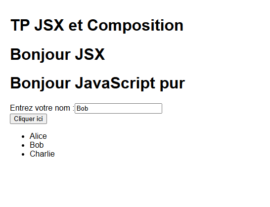

# TP 7 : Comprendre JSX, la composition avancée et les tests React

Application React réalisée dans le cadre du septième TP. Elle montre comment JSX est transformé en JavaScript, comment réutiliser de la logique avec les Higher-Order Components et les Render Props, et comment tester des composants avec Jest et Testing Library.

## Ce que le projet démontre

- le fonctionnement de JSX et sa correspondance avec `React.createElement()`
- les bonnes pratiques JSX, comme `className` et `htmlFor`
- un Higher-Order Component (HOC) qui affiche les props reçues dans la console
- un composant avec Render Props, où l'affichage est décrit par une fonction
- un test unitaire et un test d'intégration avec Jest et React Testing Library

## Prérequis

- Node.js (version LTS, 16 ou plus)
- npm
- un éditeur de code, par exemple Visual Studio Code

Pour vérifier l'installation :

```bash
node -v
npm -v
```

## Installation et lancement

Depuis le dossier du projet :

```bash
npm install
npm start
```

L'application s'ouvre sur `http://localhost:3000`. Si ce n'est pas le cas, il suffit de taper l'adresse dans le navigateur. Pour arrêter le serveur, utiliser `Ctrl + C` dans le terminal.

### Lancer les tests

```bash
npm test -- --watchAll=false
```

### Problème fréquent sous Windows

Si PowerShell indique que l'exécution de scripts est désactivée :

```powershell
Set-ExecutionPolicy -Scope CurrentUser -ExecutionPolicy RemoteSigned
```

Autre possibilité : utiliser `npm.cmd` à la place de `npm` (par exemple `npm.cmd start`).

## Structure du projet

```
src/
├── App.js
├── JSXDemo.js
├── withLogging.js
├── Button.js
├── ButtonWithLogging.js
├── DataLoader.js
├── Greeting.js
├── Greeting.test.js
├── Counter.js
├── Counter.test.js
├── setupTests.js
├── index.js
└── index.css
```

## Les composants

| Fichier | Rôle |
|---|---|
| `JSXDemo` | Affiche deux titres, l'un écrit en JSX et l'autre avec `React.createElement`, ainsi qu'un label et un champ |
| `withLogging` | HOC qui écrit les props dans la console avant d'afficher le composant enveloppé |
| `Button` | Bouton simple qui affiche le texte reçu dans la prop `label` |
| `ButtonWithLogging` | Le composant `Button` enveloppé par `withLogging` |
| `DataLoader` | Fournit une liste de noms et laisse la prop `render` décider de l'affichage |
| `Greeting` | Affiche un message de bienvenue, utilisé pour le test unitaire |
| `Counter` | Compteur avec un bouton, utilisé pour le test d'intégration |

`App.js` assemble `JSXDemo`, `ButtonWithLogging` et `DataLoader`.

## Les tests

| Fichier | Ce qui est vérifié |
|---|---|
| `Greeting.test.js` | Le composant affiche bien « Bonjour, Alice » |
| `Counter.test.js` | Un clic sur le bouton fait passer le compteur à 1 |

## Exécution

### Affichage de l'application

La page avec les deux titres, le champ de saisie, le bouton enveloppé par le HOC et la liste générée avec les Render Props.




